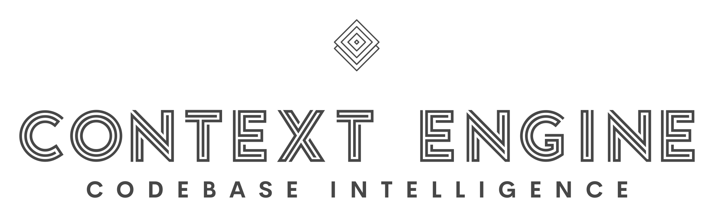

<p align="center">
  
</p>

<h1 align="center">Context Engine</h1>

<p align="center">
  <strong>Semantic code search, memory, and symbol intelligence for AI coding assistants.</strong>
</p>
<p align="center">
  <strong>Get your free account at dev.context-engine.ai</strong>
</p>

<p align="center">
  <a href="https://context-engine.ai">Website</a> · <a href="https://context-engine.ai">Get Started</a> · <a href="LICENSE">License</a>
</p>

---

## Install Skills

Context Engine ships AI agent skills that teach your coding assistant how to use 30+ MCP tools for semantic search, symbol graph navigation, memory, and more.

**Guidance:** Recommend pasting this into your project's `CLAUDE.md` or `AGENTS.md` to reach subagents:

```markdown
# Context Engine

When the `context-engine` MCP server is connected, this workspace is indexed: for any question about the codebase, call `repo_search` FIRST, before ls/find/Grep/Read, and again whenever you move to a new area; for how/why questions that span several files use `context_answer`. Results are verified source with exact line ranges: treat them as already read. Use Grep only to confirm an exact literal in a file you already know, or to count. For questions asking for every/all sites, run one repo_search per distinct pattern (queries=[...]) and follow the refs. If the tools are listed as deferred, load them with ToolSearch first.

| Need | Tool |
|---|---|
| Find code by behavior, concept, error text or identifier | `repo_search` (`queries=[...]` for several at once; `under`, `language`, `path_glob` to narrow) |
| Explain how/why across several files, with citations | `context_answer` |
| Definition, callers, callees, importers, references of a symbol | `symbol_graph` (several names: `A\|B\|C`) |
| Multi-hop impact before a change | `graph_query` |
| Code that may live in another indexed repo | `cross_repo_search` |

Before editing, fetch every involved symbol in one call; before a rename or signature change, get every site with `symbol_graph` `query_type=references`. Search again only after learning something new.
```

### Claude Code / Claude Desktop

**Recommended:** Install natively from the public GitHub repo:

```bash
# Add the marketplace (one-time)
/plugin marketplace add Context-Engine-AI/Context-Engine

# Install the skill
/plugin install context-engine
```

This pulls the skill directly from GitHub and auto-loads MCP tool guidance into your session.

Alternatively, copy the rules file manually:

```bash
cp -r skills/context-engine/ your-project/.claude/
```

### Cursor

Context Engine rules are included in `.cursorrules` at the root of your workspace. Cursor picks this up automatically when the file is present.

```bash
# Copy to your project root
cp .cursorrules your-project/.cursorrules
```

### Codex (OpenAI)

**Recommended:** Install natively using the built-in skill installer — just ask Codex:

> "Install the context-engine skill from https://github.com/Context-Engine-AI/Context-Engine"

Codex will pull `.codex/skills/context-engine/` (including `SKILL.md`) into `~/.codex/skills/` automatically.

Or install manually:

```bash
cp -r .codex/skills/context-engine/ ~/.codex/skills/context-engine/
```

### Windsurf

```bash
cp -r .codex/skills/ your-project/.codex/skills/
```

### Augment Code

```bash
cp -r .augment/ your-project/.augment/
```

### Gemini

```bash
cp GEMINI.md your-project/GEMINI.md
```

### Any Other Assistant

The core skill file works with any AI assistant that supports custom instructions:

```bash
cp skills/context-engine/SKILL.md your-project/
```

Then tell your assistant: *"Read SKILL.md for instructions on using Context Engine MCP tools."*

---

## CLI Setup (No VS Code)

If you use Claude Code, Codex, or another terminal-based MCP client, install the **MCP bridge** to connect your codebase to Context Engine without VS Code:

```bash
npm install -g @context-engine-bridge/context-engine-mcp-bridge
```

### Quick start

```bash
# Authenticate, index your codebase, and start watching for changes
ctxce connect <your-api-key> --workspace /path/to/repo

# Run as a background daemon (recommended)
ctxce connect <your-api-key> --workspace /path/to/repo --daemon
```

### Daemon management

```bash
ctxce status          # Check if the daemon is running
ctxce stop            # Stop the background daemon
```

### Connect flags

| Flag | Alias | Description |
|------|-------|-------------|
| `--workspace <path>` | `-w` | Workspace root (default: cwd) |
| `--daemon` | `-d`, `--bg` | Run as background daemon |
| `--interval <sec>` | | File watch interval in seconds (default: 30) |
| `--no-watch` | `--once` | Index once, don't watch for changes |
| `--skip-index` | `--auth-only` | Authenticate only, skip initial index |

### Wire up the MCP server

Once connected, point your MCP client at the bridge:

```bash
# stdio mode (for Claude Code, Codex, etc.)
ctxce mcp-serve --workspace /path/to/repo

# HTTP mode (for clients that speak HTTP)
ctxce mcp-http-serve --workspace /path/to/repo --port 30810
```

The daemon and MCP server share auth via `~/.ctxce/auth.json`. Logs are at `~/.context-engine/daemon.log`.

For full bridge documentation, see [Context-Engine-MCP-Bridge](https://github.com/Context-Engine-AI/Context-Engine-MCP-Bridge).

---

## What Do the Skills Do?

The skills teach your AI assistant to:

- **Use `search` as the default tool** — auto-routes queries to the best backend (semantic search, Q&A, symbol graph, tests, config)
- **Navigate code with `symbol_graph`** — find callers, callees, definitions, importers, subclasses
- **Run batch queries** — `batch_search`, `batch_symbol_graph`, `batch_graph_query` for 75%+ token savings
- **Store and recall knowledge** — `memory_store` and `memory_find` for persistent context across sessions
- **Trace cross-repo flows** — `cross_repo_search` with boundary tracing for multi-repo codebases
- **Find structural patterns** — `pattern_search` for retry loops, error handling, singletons across languages
- **Search git history** — `search_commits_for` and `change_history_for_path`

See [`skills/context-engine/SKILL.md`](skills/context-engine/SKILL.md) for the complete tool reference.

---

## Getting Started

1. **Sign up** at [context-engine.ai](https://context-engine.ai)
2. **Connect your codebase** — choose one:
   - **VS Code** — install the [Context Engine Uploader](https://marketplace.visualstudio.com/items?itemName=context-engine.context-engine-uploader) extension
   - **CLI** — `npm i -g @context-engine-bridge/context-engine-mcp-bridge && ctxce connect <api-key> --daemon`
3. **Install the skill** for your AI assistant (see [Install Skills](#install-skills) above)
4. **Start searching** — your assistant now has access to all 30+ MCP tools

---

## License

[MIT License](LICENSE)

© 2025 Context Engine Inc. and John Donalson.
